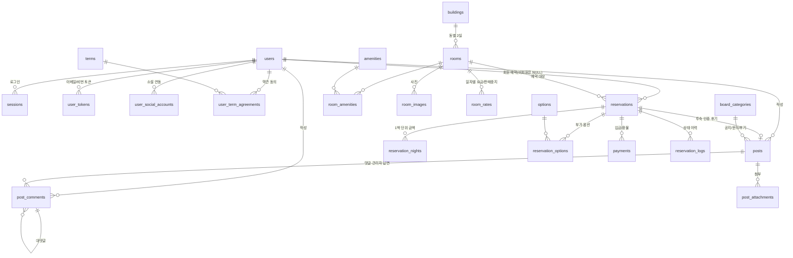

# 마음속 쉼터 — 데이터베이스 설계 (PostgreSQL)

## 1. ERD



## 2. 설계 판단 요약

| 결정 | 이유 |
| --- | --- |
| 예약 `user_id` NULL 허용 + `guest_*` 스냅샷 | 전화·비회원 예약이 실제 매출의 큰 비중. 회원 정보가 나중에 바뀌어도 예약 당시 연락처가 남아야 한다 |
| `rooms UNIQUE (building_id, floor)` | "한 동에 1층·2층 각 1실" 구조를 코드가 아니라 스키마로 보장 |
| `stay_period` 생성 컬럼 + GiST EXCLUDE | 더블부킹을 애플리케이션 검사에 맡기지 않는다. 동시 요청도 DB가 막는다 |
| 반열린 구간 `[)` | 체크아웃일과 다음 손님 체크인일이 같은 날은 정상 예약 |
| `room_rates` 일자별 캘린더 | 성수기·연휴·이벤트 요금과 청소 휴무를 요금 로직 수정 없이 데이터로 처리 |
| `reservation_nights` 스냅샷 | 요금표를 올려도 과거 예약 금액이 재계산되지 않게 |
| 게시판을 카테고리 플래그로 통합 | 공지/문의/후기를 테이블 3개로 쪼개지 않고 `admin_only`·`allow_guest`·`use_rating`로 정책만 분리 |
| `terms` 버전 관리 | 개인정보 동의 이력은 "언제, 어느 버전에 동의했는지"가 남아야 한다 |
| `site_settings` key-value | 펜션명·전화·계좌·체크인 시간처럼 자주 바뀌는 값을 배포 없이 수정 |

## 3. 자주 쓰는 쿼리

**기간별 예약 가능 객실 (실시간 예약 화면)**

```sql
SELECT * FROM fn_available_rooms(DATE '2026-09-11', DATE '2026-09-13');
```

**객실별 30일 캘린더 (상세 페이지)**

```sql
SELECT stay_date, is_booked, is_closed, price
  FROM v_room_calendar
 WHERE slug = 'star'
   AND stay_date < CURRENT_DATE + 30
 ORDER BY stay_date;
```

**예약 생성 — 겹치면 23P01로 실패한다**

```sql
INSERT INTO reservations
  (code, room_id, check_in, check_out, adults, guest_name, guest_phone,
   room_amount, total_amount, deposit_amount)
VALUES
  ('MS26010', (SELECT id FROM rooms WHERE slug = 'moss'),
   '2026-09-11', '2026-09-13', 2, '홍길동', '010-1234-5678',
   300000, 300000, 90000);
-- ERROR: conflicting key value violates exclusion constraint "reservations_no_overlap"
```

**월별 매출 / 점유율**

```sql
SELECT date_trunc('month', check_in) AS month,
       count(*)                       AS 예약건수,
       sum(nights)                    AS 판매객실수,
       sum(total_amount)              AS 매출,
       round(sum(nights)::numeric
             / (6 * extract(day FROM date_trunc('month', check_in)
                                    + INTERVAL '1 month - 1 day')) * 100, 1) AS 점유율
  FROM reservations
 WHERE status IN ('confirmed', 'completed')
 GROUP BY 1
 ORDER BY 1 DESC;
```

**입금 미확인 예약 자동 취소 대상 (24시간 경과)**

```sql
SELECT code, guest_name, guest_phone, total_amount
  FROM reservations
 WHERE status = 'pending'
   AND payment_status = 'unpaid'
   AND created_at < now() - INTERVAL '24 hours';
```

**게시판 목록 + 답변 여부**

```sql
SELECT id, category_name, title, author_name, created_at, comment_count
  FROM v_board_list
 WHERE category_slug = 'inquiry'
 LIMIT 20;
```

**회원 가입 / 로그인 검증 (pgcrypto 사용 시)**

```sql
-- 가입
INSERT INTO users (email, password_hash, name, phone)
VALUES ('guest@example.com', crypt('평문비밀번호', gen_salt('bf', 10)), '홍길동', '010-1234-5678');

-- 로그인
SELECT id, name, role
  FROM users
 WHERE email = 'guest@example.com'
   AND password_hash = crypt('입력한비밀번호', password_hash)
   AND status = 'active';
```

> 애플리케이션에서 argon2/bcrypt로 해시할 경우 `crypt()` 대신 앱에서 계산한 해시를 넣으면 됩니다.
> `db/seed.sql`의 관리자 계정은 `admin@maeumsok.kr / admin1234` 이며 운영 배포 전 반드시 변경해야 합니다.

## 4. 마이그레이션 운영

MVP 단계라 `schema.sql` 단일 파일로 두었습니다. 스키마 변경이 시작되면
`db/migrations/0001_init.sql` 형태로 쪼개고 node-pg-migrate 또는 Prisma Migrate로 이관하는 것을 권합니다.
`schema.sql`은 모든 객체에 `IF NOT EXISTS`를 쓰지 않으므로 **빈 DB에 1회 실행**을 전제로 합니다.
